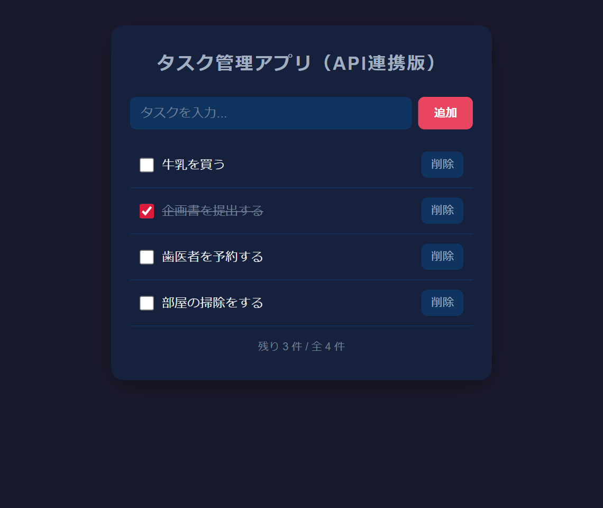
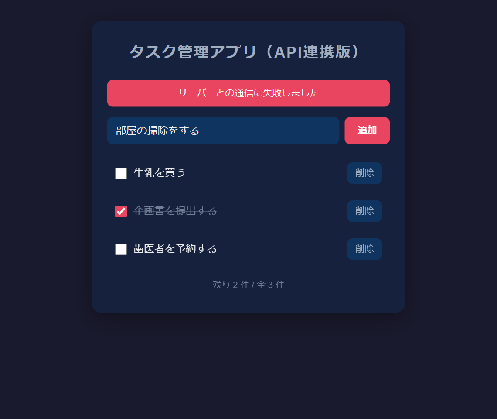

# ポートフォリオ

## 概要
Vanilla JavaScript の画面と FastAPI の API をつないで実装したタスク管理アプリです。  
ZennのWEB書籍を執筆するために制作しました。  
アプリ名：TaskApp（API連携版）  
WEB書籍：[JavaScript×FastAPI入門 - タスク管理アプリをAPIとつないでみよう!](https://zenn.dev/eguchi244_dev/books/js-fastapi-integration-eguchi244)

 

## 制作経緯
本アプリとWEB書籍は、別々に作った画面（フロントエンド）と API（バックエンド）を1つのアプリとしてつなぐ基本を学ぶチュートリアル教材として活用したいという気持ちから制作しました。

制作にあたっては下記の項目を

* わざと CORS エラーを起こしてから設定でつなぎ、オリジンと CORS の仕組みを体験できる
* `fetch` と `async` / `await` で、GET / POST / PUT / DELETE のリクエストを送れる
* 書き込んだら必ず一覧を取り直し、サーバーを唯一の正しいデータの置き場所として扱う
* 通信中のローディング表示と、通信に失敗したときのエラー表示を1か所（`apiCall`）にまとめる
* 前作の画面の「状態 → 描画 → イベント」の骨格を変えずに、データの置き場所だけを localStorage から API へ移す

満たす体験を実現するようにしました。

## 要件&仕様
本アプリは下記の

* ページ読み込み時に API からタスク一覧を取得して表示する
* タスクの追加・完了切り替え・削除を、それぞれ POST / PUT / DELETE のリクエストで API に反映する
* 完了切り替えは `completed` だけを送る部分更新とする
* API のリクエスト中は「通信中...」を表示し、失敗したときは「サーバーとの通信に失敗しました」を画面に表示する
* 画面（Live Server）と API（Uvicorn）は別々のプロセスで動かし、API 側の CORS 設定で通信を許可する
* 画面は外部ライブラリを使わず、データは API の SQLite に保存する

を要件とする簡易なアプリです。

## システム構成
【技術スタック】
* HTML5 / CSS3 / JavaScript（ES6+）, Fetch API
* Python 3.10+
* FastAPI, Uvicorn, Pydantic v2
* SQLAlchemy
* SQLite

【ディレクトリ構成】
```
JS-FastAPI-Integration-Tutorial-PJ（ルートディレクトリ）
├── backend
│   ├── main.py            # FastAPI アプリ（CORS 設定・データベースの設定・モデル・エンドポイント）
│   └── requirements.txt   # 使うライブラリ
├── frontend
│   ├── index.html         # 画面（ローディング・エラー表示欄つき）
│   ├── style.css
│   └── script.js          # fetch による API 通信・描画・ローディング/エラー表示
├── img                    # README の画面
└── README.md
```

## WEB書籍の章とブランチ
WEB書籍の入門03で取得する出発点のコードと、各章の末尾にある「ここまでのソースコード」は、下記のブランチを指しています。答え合わせにご活用ください。

| 章 | ブランチ | 内容 |
|---|---|---|
| [入門03 - 2つのプロジェクトを合流させる](https://zenn.dev/eguchi244_dev/books/js-fastapi-integration-eguchi244/viewer/js-fastapi-merge) | `Start/出発点のコード` | 入門03で取得する出発点（前作の画面と API の完成版） |
| [入門03 - 2つのプロジェクトを合流させる](https://zenn.dev/eguchi244_dev/books/js-fastapi-integration-eguchi244/viewer/js-fastapi-merge) | `Chapter03/2つのプロジェクトを合流させる` | 入門03を終えた時点のコード |
| [入門04 - CORS設定と一覧取得](https://zenn.dev/eguchi244_dev/books/js-fastapi-integration-eguchi244/viewer/js-fastapi-cors-fetch) | `Chapter04/CORS設定と一覧取得` | 入門04を終えた時点のコード |
| [入門05 - 追加・完了切り替え・削除をAPIにつなぐ](https://zenn.dev/eguchi244_dev/books/js-fastapi-integration-eguchi244/viewer/js-fastapi-crud) | `Chapter05/追加・完了切り替え・削除をAPIにつなぐ` | 入門05を終えた時点のコード |
| [入門06 - ローディングとエラーの表示](https://zenn.dev/eguchi244_dev/books/js-fastapi-integration-eguchi244/viewer/js-fastapi-loading-error) | `Chapter06/ローディングとエラーの表示` | 入門06を終えた時点のコード（完成版と同じ） |
| ― | `main` | 完成版 |

## 前提条件
PCに下記がインストールされていること。

* Python 3.10 以上
* VS Code と Live Server 拡張機能（画面の表示に使う）
* Git（ZIP でダウンロードする場合は不要）
* モダンブラウザ

## 環境構築
Github から TaskApp（API連携版）をローカル環境に構築する手順です。  
任意の作業フォルダ内で下記を実施してください（PowerShell の例）。

1. GitHubよりプロジェクトをダウンロードする
```
$ git clone https://github.com/eguchi244/JS-FastAPI-Integration-Tutorial-PJ.git
$ cd JS-FastAPI-Integration-Tutorial-PJ
```
2. 章の途中のコードを見たい場合は、ブランチを切り替える（任意）
```
$ git switch Chapter04/CORS設定と一覧取得
```
3. `backend` に仮想環境を作り、ライブラリをインストールする
```
$ cd backend
$ python -m venv venv
$ .\venv\Scripts\Activate.ps1
$ python -m pip install -r requirements.txt
```

## 動作確認
1. API を起動する（`backend` で、仮想環境を有効にした状態）
```
$ uvicorn main:app --reload
```
2. 画面を開く  
VS Code で `frontend/index.html` を右クリック →「Open with Live Server」で開きます。
3. タスクを操作する  
タスクを追加・完了切り替え・削除すると、そのたびに API と通信して一覧が描き直されます。リロードしても、別のブラウザで開いても同じ一覧が表示されます（データは `backend/tasks.db` に保存され、初期状態に戻すときは API を止めて削除します）。
4. 通信の失敗を確かめる  
API を止めて（`Ctrl + C`）からタスクを追加すると、「サーバーとの通信に失敗しました」が表示され、入力欄の文字は消えずに残ります。
